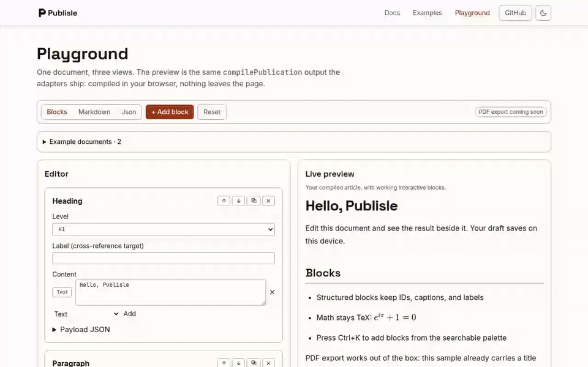

<div align="center">
  <picture>
    <source media="(prefers-color-scheme: dark)" srcset="docs/assets/brand/lockup-dark.svg" />
    
  </picture>
  <p><strong>Portable semantic articles, compiled into static content with optional interactive islands.</strong></p>
  <p>
    <a href="https://github.com/VoidReg/publisle/actions/workflows/release.yml"></a>
    
    
  </p>
</div>

Publisle turns Markdown or typed JSON into static articles with optional
interactive islands. Research tools add LaTeX, JATS, and PDF export.

## Quickstart

Requires Node.js 24+.

```sh
npm install -g @publisle/cli
cat > article.md <<'EOF'
---
title: My first article
---

# Hello, Publisle

Readable articles start with Markdown.
EOF
publisle build article.md --out dist/
```

Open `dist/index.html` to read the article. Interactive blocks keep their authored
fallbacks; attach a host runtime to make them interactive.

[Try the playground](https://publisle.xyz/playground) — edit Markdown, preview an
article, and explore an interactive FFT butterfly.



Publisle is in beta. See the [supported features and limits](docs/standards/README.md).

## Core in-process quickstart

```sh
npm i @publisle/schema @publisle/blocks-core @publisle/core @publisle/adapter-core
```

```ts
import { document } from "@publisle/schema";
import { paragraph, coreBlockDefinitions } from "@publisle/blocks-core";
import { createRegistry, prepare, assertPrepared } from "@publisle/core";
import { compilePublication } from "@publisle/adapter-core";

const article = document({
  metadata: { title: "First article", language: "en" },
  blocks: [
    paragraph({
      content: [{ type: "text", value: "Readable without JavaScript." }],
    }),
  ],
});
const prepared = assertPrepared(
  prepare(article, { registry: createRegistry(coreBlockDefinitions) }),
);
const publication = compilePublication(prepared);
```

Render `publication.html` in your application. See the
[framework host guide](docs/guides/framework-hosts.md) for styles and interactive
runtimes. Core includes no Research or TeX tooling.

## Research profile

```sh
npm install -g @publisle/cli-research
```

Adds citations, publisher templates, and LaTeX/JATS/PDF export.
See the [export guide](docs/guides/journal-export.md) for setup and usage.
PDF tooling is installed separately; template availability does not imply journal
acceptance or PDF/UA certification.

## Integrate and extend

- [Documentation](docs/README.md)
- [Framework hosts](docs/guides/framework-hosts.md)
- [Custom blocks and codecs](docs/developer-guide.md)
- [Portable documents and offline assets](docs/guides/exchange.md)

## Try the playgrounds

For local development, use Node.js 24+ and pnpm 11.17+ (11.x):

```sh
git clone https://github.com/VoidReg/publisle.git
cd publisle
pnpm install
pnpm --filter @publisle/playground-svelte dev
# Or: pnpm --filter @publisle/playground-react dev
```

## Development

See [Contributing](CONTRIBUTING.md) for setup and checks, the
[Code of Conduct](CODE_OF_CONDUCT.md) for community expectations, and
[Discussions](https://github.com/VoidReg/publisle/discussions) for questions and ideas.

## License

[MIT](LICENSE) — Copyright © 2026 VoidReg.
